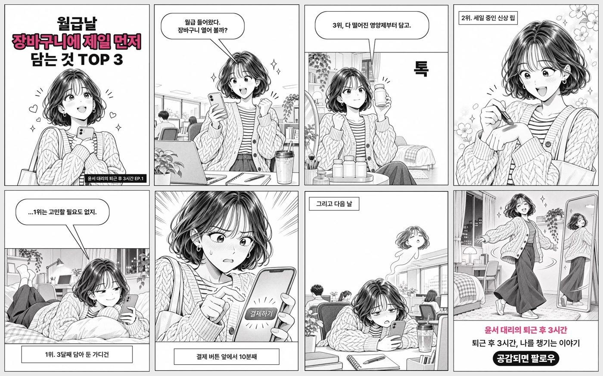

# instatoon

연재 인스타툰을 Codex 안에서 만드는 스킬 패키지. 그림체 구성 → 캐릭터 시트 승인 → 주제 선택 → 콘티 → Codex 내장 이미지 생성(글자 없는 그림) → 말풍선·표지·엔딩 식자 → QA → 1080x1350 내보내기. 웹앱, API 키, 비용 계산은 없다.

## 설치

    git clone https://github.com/jehyeonan/instatoon.git ~/.codex/skills/instatoon

또는 Releases 의 zip 을 받아 압축을 풀면 instatoon/ 폴더가 나온다. 그 폴더를 ~/.codex/skills/ 아래에 둔다.

설치 뒤 Codex 를 새로 열면 스킬 목록에 instatoon 이 보인다. 이미지 생성은 Codex 내장 이미지 생성 기능을 쓰므로 API 키가 필요 없다.

Python 3.9 이상, bash 필요. `scripts/toon` 은 uv 가 있으면 `uv run --no-project --quiet --with pillow` 로 실행한다. uv 가 없으면 `${XDG_CACHE_HOME:-$HOME/.cache}/instatoon/venv` 에 venv 를 만들고, 실행할 때마다 `import PIL` 을 확인해 실패하면 Pillow 를 다시 설치한다(첫 실행에 네트워크 필요). python3 가 3.9 미만이면 안내하고 종료한다. 데이터는 스킬 폴더가 아닌 작업 폴더(시리즈 루트)에 쌓인다.

아래 예의 `toon` 은 전체 경로 `$HOME/.codex/skills/instatoon/scripts/toon` 이다. 줄여 쓰려면:

    alias toon="$HOME/.codex/skills/instatoon/scripts/toon"

## 사용 흐름

Codex 에서 "인스타툰 만들자"처럼 말하면 SKILL.md 의 절차를 따른다. 정지점: G0 그림체 승인, G1 캐릭터 시트 승인, G2 주제 선택, G3 콘티 승인, G4 장별 승인, G5 내보내기 확인. 직접 쓸 때:

    toon init mytoon --title "내 시리즈"
    cd mytoon
    toon style presets                                   # 레퍼런스가 있으면: toon style ref add 그림.png
    toon style prompt --presets bw_manga,doodle,chibi    # 같은 장면 샘플 프롬프트 3개
    toon style ingest sample1.png --preset bw_manga      # image_gen 결과 등록
    toon style approve
    toon character add hero --name 주인공 --role main
    toon character ingest hero ~/Downloads/sheet.png && toon character approve hero
    toon episode new
    # storyboard.json 작성
    toon prompt 1                 # 장별 프롬프트 + jobs.json
    toon ingest 1 2 gen.png       # image_gen 결과 등록
    toon grid 1 2                 # 좌표 격자
    # letter.json 작성
    toon letter 1 && toon qa 1
    toon approve 1 2
    toon export 1

식자 뒤 이미지 버전이 바뀌거나 letter.json 을 고치면 lettered.png 가 낡은 것이 되어 승인과 내보내기가 거부된다("toon letter 를 다시 실행하세요"). `toon letter` 로 다시 식자하면 그 장의 승인은 해제되므로 확인 후 `toon approve` 를 다시 한다. `toon ingest` 로 새 버전이 채택될 때도 승인이 해제된다.

## 명령

| 명령 | 설명 |
| --- | --- |
| init <dir> --title T [--handle H] | 시리즈 폴더와 series.json 템플릿 |
| style presets | 그림체 프리셋 목록 |
| style set (--preset ID \| --bible "...") [--palette bw\|mono_accent\|color] | 그림체 지정(바뀌면 승인 해제) |
| style ref add <이미지...> / style ref list | 레퍼런스 이미지 등록, style/refs/ |
| style prompt [--presets a,b,c] [--scene "..."] | 비교용 샘플 프롬프트와 jobs JSON |
| style ingest <png> [--preset ID] | 샘플 등록(4:5 밖은 rejected) |
| style approve [--version N] | 샘플 승인(프리셋이면 bible 동기화) |
| character add <id> --name N --role main\|support [--no-style] | 캐릭터 폴더, character.json, 시트 프롬프트(승인된 그림체 샘플이 있어야 함) |
| character prompt <id> [--no-style] | lock_prompt 반영해 시트 프롬프트 새 버전 |
| character ingest <id> <png> | 시트 버전 등록 |
| character approve <id> [--version V] | 승인 시트 지정 |
| formats [ID] | 포맷 16종 목록 / 한 포맷의 장별 역할 |
| episode new [--n N] [--format F] | 에피소드 폴더, episode.json, 포맷의 장별 역할을 담은 storyboard.json 틀(없는 포맷은 거부) |
| prompt <ep> [--pages 2,5] [--no-sheets] | 콘티 검증 후 장별 prompt_vN.txt, jobs.json 출력 |
| ingest <ep> <page> <png> [--edit-of N] | 새 버전 등록(가로 등 비율 불량은 rejected 기록) |
| grid <ep> <page> | 10% 격자 + 좌표 라벨 grid.png |
| letter <ep> [--pages] | letter.json 으로 lettered.png (표지·엔딩 자동 문구) |
| qa <ep> | 자동 검사 + 시각 점검 목록, qa.json |
| approve <ep> <page> [--version V] [--force] | 장 승인. 식자가 최신이어야 하고, 마지막 qa 에 그 장 오류가 있으면 거부(--force 로 qa 오류만 무시) |
| export <ep> [--force] | out/01.jpg.., preview.jpg, caption.txt (--force 는 미승인만 허용, 식자 최신성은 항상 검사) |
| status [ep] | 그림체 상태, 장별 상태, 생성 수, 재생성률 |

모든 명령에 `--root <시리즈 폴더>` 를 줄 수 있다. 주면 그 폴더만 보고(위로 탐색하지 않음) series.json 이 없으면 오류다. 없으면 현재 위치에서 위로 series.json 을 찾는다.

규칙: 이미지 비율은 0.78~0.82(4:5) 안이어야 하고(밖이면 ingest 가 rejected), export 는 이 범위 안에서 중앙 크롭한다. qa 는 크롭 밖으로 나가는 풍선을 오류로 본다. canvas 는 4:5 세로만 지원한다(예: [1080, 1350]). character id 와 cast id 는 영문, 숫자, _, - 만 쓴다. 색상은 #RGB 또는 #RRGGBB. jobs.json 과 page.json 의 파일 경로는 시리즈 루트 기준 상대 경로로 저장한다(옛 절대 경로도 읽는다). rejected 버전은 채택, 식자, 승인에 쓸 수 없다.

export 는 모든 장을 검증하고 out.tmp 에 다 만든 뒤에만 out/ 으로 옮긴다. out/ 에서는 NN.jpg, preview.jpg, caption.txt 만 교체·정리하고 그 밖의 파일은 그대로 둔다.

## 폴더

    series.json  style/{refs/, sample_vN.png, sample_prompt_vN*.txt}  characters/<id>/character.json  episodes/epNN/{episode.json, storyboard.json, jobs.json, qa.json, out/}
    episodes/epNN/pages/pNN/{prompt_vN.txt, gen_vN.png, page.json, letter.json, lettered.png, grid.png}
    episodes/epNN/pages/pNN/lettered.json   식자 기준(채택 버전)
    ledger.jsonl   생성 요청 기록(감사용, 재현 보장 아님)

## 테스트

    python -m unittest                       # 스킬 폴더에서
    python tests/e2e_example.py              # 생성 없이 예제 E2E (결과 /tmp/instatoon_e2e)

## 예제 시리즈

examples/yunseo 는 가상의 예시 시리즈 「윤서 대리의 퇴근 후 3시간」이다. 29세 마케팅 대리 윤서가 퇴근 후 자기 관리·쇼핑·취미에서 겪는 공감 에피소드로, 인스타그램에서 SNS 구매 경험이 가장 높은 20~30대 여성 직장인을 독자로 가정했다. 뷰티·패션·영양제처럼 협찬·공구로 이어지기 쉬운 소재가 자연스럽게 나오도록 잡았다.

- series.json, characters/yunseo/character.json, EP.1 「월급날 장바구니에 제일 먼저 담는 것 TOP 3」의 episode.json·storyboard.json·장별 letter.json
- sheet_preview.jpg: 이 스킬로 만든 캐릭터 시트 축소본
- ep01_preview.jpg: 이 스킬로 끝까지 만든 EP.1 8장 미리보기

예제로 시작하려면 폴더를 작업 위치에 복사하고, 캐릭터 시트를 생성해 `toon character ingest yunseo <png>` → `toon character approve yunseo` 한 뒤 `toon prompt 1` 부터 진행한다. 예제 콘티의 장면 문구가 그림 여백을 지정하므로 예제 letter.json 은 새로 생성한 그림에서는 위치를 다시 잡아야 할 수 있다.

## 알려진 한계

- 자동 QA 는 그림 내용(캐릭터 속성, 로고, 목록 밖 글자, 실존 인물, 풍선이 얼굴을 가리는지)을 보지 못한다. view_image 로 직접 확인해야 한다.
- 풍선 위치는 에이전트가 격자 이미지를 보고 정한다. 자동 얼굴 회피는 없다.
- 이미지 생성은 에이전트가 image_gen 을 호출하는 방식이라 이 패키지의 명령만으로는 생성되지 않는다. ledger 는 ingest 시점 기록이다.
- 한국어 줄바꿈은 공백(어절) 기준이다. 금칙 처리는 없다.

## 라이선스

코드와 문서는 MIT(LICENSE). fonts/ 의 Pretendard, Nanum Pen Script 는 SIL Open Font License 1.1(LICENSES.md).
